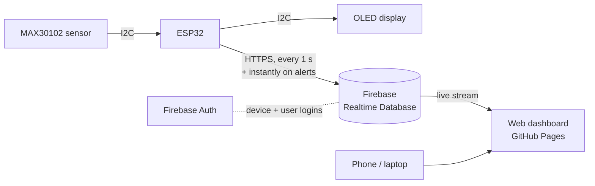

# PulseNode

**IoT pulse oximeter and heart rate monitor.** An ESP32 reads heart rate and blood oxygen (SpO₂), shows them on an OLED screen, and streams them to the cloud, where signed-in users watch live readings, trends and alerts from any phone or computer.

**Live dashboard:** https://imnottmoee.github.io/PulseNode/ (account required)

> **Status:** the full device → cloud → dashboard pipeline is working end to end. The vitals are currently **simulated** on the ESP32 while the MAX30102 sensor is being integrated; the dashboard labels this data "SIMULATED".

> ⚠️ Student portfolio project. **Not a medical device.** Do not use it for medical decisions.

---

## Features

**Device (ESP32 + OLED)**
- Live heart rate, SpO₂ and a scrolling pulse waveform on a 0.96" OLED
- On-device alerts: low SpO₂ (< 92 %), low heart rate (< 50 BPM), high heart rate (> 120 BPM). The screen flashes and shows the alert
- Dual-core firmware: the display runs on one core while cloud uploads run on the other, so network delays never freeze the screen
- Signs in to Firebase with its own device account and renews its access token automatically
- Uploads once per second, plus **immediately** when an alert starts or clears
- Reconnects to Wi-Fi and retries uploads automatically after dropouts

**Cloud (Firebase)**
- Firebase Realtime Database for live readings
- Firebase Authentication for user accounts and the device account
- Locked security rules: only signed-in users can read live data, only the device account can write it, and each user can only access their own profile data

**Web dashboard**
- Name + 6-digit PIN accounts (create account / log in)
- Live heart rate and SpO₂ with Normal / Low / High status tags
- Trend charts with alert-threshold lines and 1 min / 5 min / All time ranges
- Flashing alert banner and an alert log with start times and durations
- Session summary: min / average / max, reading count, alerts, time in alert
- Device health: Wi-Fi signal strength, uptime, firmware version, upload time and delivery delay
- Works on phone and desktop (single self-contained HTML file hosted on GitHub Pages)

## How it works



1. The ESP32 measures (currently simulates) heart rate and SpO₂ and draws them on the OLED.
2. A background task on the ESP32's second core signs in as the device and writes the latest reading to `devices/pulsenode-01/live` in Firebase once per second.
3. The dashboard signs the user in and subscribes to that path, so new readings appear within about a second.

## Hardware

| Part | Notes |
|---|---|
| ESP32-WROOM-32 dev board (30-pin) | Dual-core MCU with built-in Wi-Fi |
| MAX30102 module (MH-ET LIVE) | Red + IR optical sensor for heart rate and SpO₂ |
| 0.96" SSD1306 OLED, 128×64, I2C | Two-color (yellow header band, blue body) |
| Breadboard and jumper wires | |

### Wiring (shared I2C bus)

| Signal | ESP32 pin | OLED | MAX30102 |
|---|---|---|---|
| 3.3 V | 3V3 → + rail | VCC | VIN |
| Ground | GND → − rail | GND | GND |
| Data (SDA) | GPIO 21 | SDA | SDA |
| Clock (SCL) | GPIO 22 | SCL | SCL |

I2C addresses: OLED `0x3C`, MAX30102 `0x57`.

## Repository layout

```
index.html                         Web dashboard (served by GitHub Pages)
database.rules.json                Firebase Realtime Database security rules
firmware/PulseNode/PulseNode.ino   ESP32 firmware
firmware/PulseNode/secrets.example.h  Template for Wi-Fi and Firebase credentials
```

## Setup

**Firmware**
1. Install Arduino IDE 2.x, the **esp32 by Espressif Systems** board package, and the libraries **Adafruit SSD1306** (with Adafruit GFX) and **SparkFun MAX3010x**.
2. Copy `firmware/PulseNode/secrets.example.h` to `secrets.h` in the same folder and fill in your Wi-Fi details, device account and Firebase API key. `secrets.h` is git-ignored.
3. Board: **ESP32 Dev Module**. Upload, then check the Serial Monitor (115200 baud) for `Device signed in to Firebase` and `HTTP 200`.

**Firebase**
1. Create a project with a Realtime Database and enable **Email/Password** authentication.
2. Add a user for the device (e.g. `device-01@pulsenode.app`) and put its UID into `database.rules.json`.
3. Publish `database.rules.json` as the database rules.

**Dashboard**
1. Put your Firebase web config into `index.html`.
2. Host it anywhere static (this repo uses GitHub Pages) and create an account on the login screen.

## Roadmap

- [x] OLED display with live vitals, waveform and alerts
- [x] Wi-Fi and Firebase cloud uploads (1 s rhythm + instant alerts)
- [x] Live web dashboard with trends, alert log and device health
- [x] User accounts with PINs and locked database rules
- [ ] Real MAX30102 readings with signal filtering, peak detection and SpO₂ (ratio-of-ratios)
- [ ] Finger detection and signal-quality indicator
- [ ] "Start measurement" sessions saved to each user's history
- [ ] Home-screen app (installable web app)
- [ ] Per-user alert thresholds and phone notifications
- [ ] Accuracy validation against a commercial pulse oximeter

## Tech

ESP32 (Arduino / FreeRTOS tasks) · I2C · Adafruit SSD1306 · Firebase Realtime Database + Authentication (REST on the device, JS SDK on the web) · HTML/CSS/JavaScript · Chart.js · GitHub Pages
